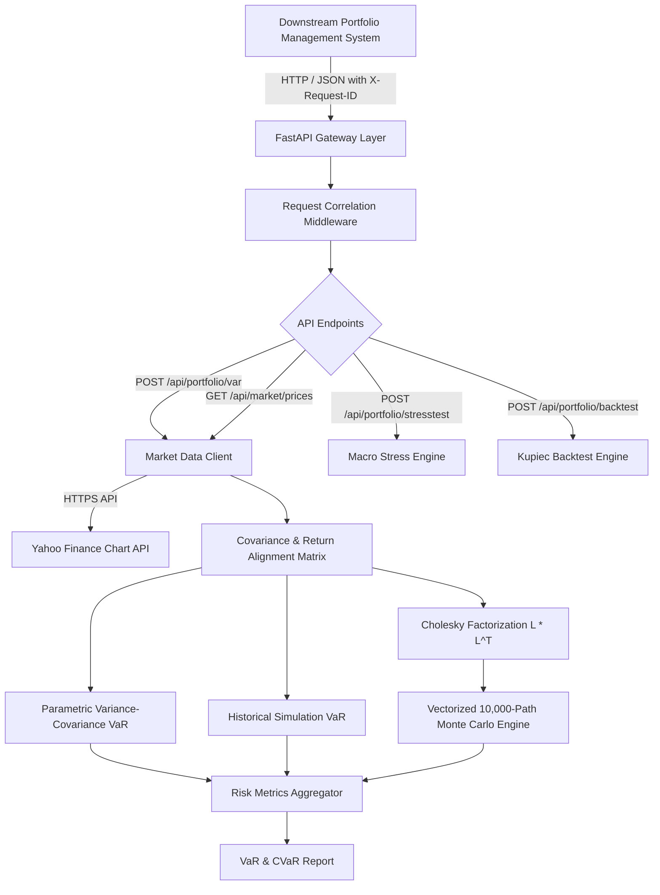

# Architecture: Quant VaR Portfolio Stress Tester

## System Architecture

The **Quant VaR Portfolio Stress Tester** provides institutional-grade market risk calculations across equity, fixed income, and commodity portfolios. It ingests live historical price series from Yahoo Finance, computes aligned return matrices, evaluates Parametric, Historical, and Monte Carlo Value-at-Risk (VaR) and Expected Shortfall (CVaR), and executes historical macro stress tests alongside Kupiec POF backtesting.

## Quantitative Methodology

### 1. Covariance & Portfolio Volatility
Given an aligned asset returns matrix $R \in \mathbb{R}^{T \times N}$, the sample covariance matrix $\Sigma \in \mathbb{R}^{N \times N}$ is computed and regularized for positive semi-definiteness:
$$\sigma_p = \sqrt{w^T \Sigma w}, \quad \sigma_{\text{ann}} = \sigma_p \cdot \sqrt{252}$$

### 2. Parametric VaR & Expected Shortfall (CVaR)
Using the inverse cumulative distribution function $Z_{\alpha} = \Phi^{-1}(\alpha)$:
$$\text{VaR}_{\alpha} = Z_{\alpha} \cdot \sigma_p \cdot V, \quad \text{CVaR}_{\alpha} = \frac{\phi(Z_{\alpha})}{1 - \alpha} \cdot \sigma_p \cdot V$$

### 3. Historical Simulation VaR
Historical daily portfolio returns are projected via $R_p = R w$. Value-at-Risk is evaluated directly from empirical empirical percentiles:
$$\text{VaR}_{\alpha} = -Q_{1-\alpha}(R_p) \cdot V, \quad \text{CVaR}_{\alpha} = -\mathbb{E}[R_p \mid R_p \le -Q_{1-\alpha}(R_p)] \cdot V$$

### 4. Vectorized Monte Carlo via Cholesky Factorization
Simulates 10,000 correlated asset paths by decomposing the covariance matrix:
$$\Sigma = L L^T$$
$$R_{\text{sim}} = \mu + L Z, \quad Z \sim \mathcal{N}(0, I)$$
$$R_{p, \text{sim}} = w^T R_{\text{sim}}$$

### 5. Kupiec Proportion of Failures (POF) Likelihood-Ratio Backtest
Tests whether empirical breach frequencies exceed expected tolerance $\alpha$:
$$LR = -2 \ln \left[ \frac{(1 - p)^{N - x} p^x}{(1 - \hat{p})^{N - x} \hat{p}^x} \right] \sim \chi^2(1)$$
If $p \ge 0.05$, the risk model is statistically accepted.
